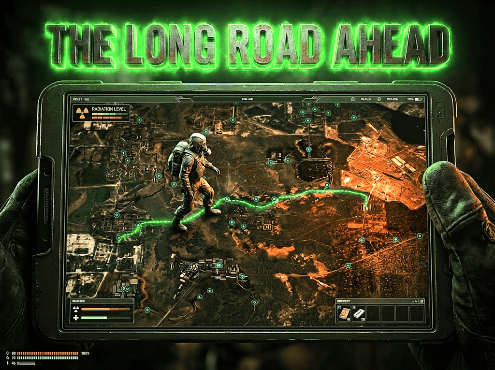

<div align="center">

<sub>S.T.A.L.K.E.R. ANOMALY / G.A.M.M.A.</sub>

# THE LONG ROAD AHEAD
### CONTINUOUS ZONE-TO-ZONE TRAVEL

*Ditch instant teleports. Experience the journey. Watch your back.*

  

**[Full Changelog](CHANGELOG.md)** · **[Latest Release](https://github.com/DamageZedd/The-Long-Road-Ahead/releases/latest)**

</div>

> ⚠️ **FULL RELEASE – PLEASE READ**  
> The Long Road Ahead is a comprehensive travel simulation overhaul and continuous Zone travel mod. Please report any issues you encounter so they can be fixed in future updates. Back up your saves before updating.

The Long Road Ahead is a comprehensive fast travel overhaul and continuous Zone travel simulation mod for S.T.A.L.K.E.R. Anomaly and G.A.M.M.A., inspired by the travel mechanics of *Kingdom Come: Deliverance*. Ditch immersion-breaking instant teleportation: travel takes real time, drains stamina and calories, advances the world clock, and tracks your physical movement across the Zone.

Right-click any discovered map spot, fast-travel marker, or guide to set out. Your journey traverses intermediate territories in accelerated time, plotting animated breadcrumbs across the PDA map. Dynamic threat detection continuously scans nearby ALife simulation squads and mutant packs, pulling you out of travel for dangerous roadside ambushes or giving veteran stalkers a chance to slip past under the cover of night or stormy weather.

---

## 🆕 New in v2.3.1

### 👥 Authoritative Companion Recall & Useful Idiots Stance Synchronization
- **Authoritative Manual Recall (`\` Key)**: Completely overhauled companion recall initiated via the `\` hotkey (or MCM-configured squad teleport key). Intercepts and replaces Fair Fast Travel's broken `bring_companions_to_actor` logic with TLRA's robust, authoritative multi-member teleport system.
- **Useful Idiots Stance Bypass**: Manual recall (`forced = true`) deliberately bypasses Useful Idiots stance restrictions (`companion_squad_can_teleport`), allowing players to summon companions even if they are stuck in wait, cover, relax, or patrol mode across levels or switch distance, while safely preserving quest hostage protections.
- **Staggered Radial Distribution**: Teleported companions now calculate radial offset positions (1.8m–3.0m) around the player with AI level vertex validation, completely eliminating companion physics collisions, mesh stacking, and terrain clipping.
- **Offline & Cross-Level Alife Synchronization**: Safely teleports server entities via `sim:teleport_object`, invalidates stale offline caches (`db.offline_objects`, `db.spawned_vertex_by_id`), clears animation states (`safe_reset_animation`), and smoothly synchronizes client positions.
- **Standalone Hotkey Fallback**: Added standalone `on_key_release` listener with UI dialog focus checking and 800ms debounce protection so manual recall operates reliably even if Fair Fast Travel is uninstalled or disabled.
- **Status Notification**: Added clean, non-intrusive on-screen HUD message feedback indicating the number of companions successfully recalled.

---

## 🆕 New in v2.3.0

### ⏱️ Dynamic Travel & Time Progression
Travel duration is no longer fixed at a rigid 2 minutes regardless of distance. Travel time dynamically scales based on actual world vector distance, walking speed, active encumbrance, and time acceleration factors. Journeys across multiple territories feel substantial, perilous, and physically grounded.

### 🍗 Dynamic Survival Stats & Diet System Support
Hunger, thirst, and fatigue properly accumulate over the course of the journey based on exact game-time elapsed. Features full native integration with the **Diet System** mod: carbohydrates, fats, and protein reserves deplete over the trip alongside vanilla/GAMMA thirst (`actor_status_thirst`) and sleep (`actor_status_sleep`). Reworked travel economy removes illogical self-paid ruble charges for walking journeys—you pay with physical calories, fatigue, and in-game time.

### 🎒 Carry Weight & Over-Encumbrance Physics
Real carrying capacity is dynamically calculated from equipped suits, backpacks, belt artifacts, and active boosters. Traveling while heavily encumbered severely degrades movement speed and exponentially accelerates stamina and calorie consumption.

### 👥 Multi-Member Squad Synchronization
Companion squads now cleanly transition across level borders utilizing `axr_companions.companion_squads` and `squad:squad_members()`. Resets companion animations (`sim_squad_scripted.reset_animation`), synchronizes level vertex positions, and clears stale offline flags to prevent companions from getting stuck or desynced upon arrival.

---

## 🆕 New in v2.2.2

### 🌐 Russian Localization
Added full Russian translation (`rus/st_tlra_mcm.xml`). All MCM settings, descriptions, in-game notifications, roadside atmosphere events, guide dialogue, stealth dodge results, and positive event messages are now fully translated. Russian players can install GAMMA/Anomaly with a Russian UI and experience all mod text natively without script changes.

---

## 🆕 New in v2.2.0 & v2.1.9

### 🛡️ Arrival Offset & Safety Hardening
New MCM setting (default **10m**) to spawn before the destination marker instead of directly on top of it, avoiding hostile smart terrain ambushes. Switched to manual 2D vector length calculation `math.sqrt(dx*dx + dz*dz)` for full X-Ray Lua engine stability, extended safety window to **15.0s**, and integrated optional SafeSpawn mod clearing (`perform_silo`).

---

## 🆕 New in v2.0.9

### 🥷 Dynamic Encounter Sneaking & PDA Holster
Added dynamic stealth system to slip past detected threats during travel, scaling with character rank, nighttime darkness, and bad weather. Cleanly auto-holsters 3D PDA device UI and equips Slot 2 primary weapon upon travel completion, voluntary abort, or roadside encounter.

---

## 🚶 The Road & Travel Mechanics

- Continuous Zone-to-Zone travel across intermediate territories with shortest-path BFS routing
- Real-time animated breadcrumb waypoints (**4–24 dots**) on the PDA map
- Time acceleration (**1–50x**) advances world clock, sun, circadian rhythms, and weather naturally
- Simulated walking pace (**10–50 m/s**, default **25 m/s**)
- "The Final Leg" border travel option: stops at transition boundary, leaving the remaining distance to walk on foot
- Cinematic vignette effect and ambient travel wind sound
- Ambient roadside thoughts and atmospheric event messages during transit

## ⚔️ Ambush Tech & Threat Detection

- Real-time ALife radar actively scans simulation squads and mutant packs within threat range of your virtual path
- Passing near hostile camps, stalker patrols, or mutant packs interrupts travel for immediate combat
- Safe Zone Protection: **100m** threat-free perimeter around departure and destination
- Percentage-based RU refunds: aborting or being ambushed refunds travel costs for the uncompleted leg
- Safe Waypoint Spawning: aborting or being ambushed safely snaps to the nearest validated AI node (`level_vertex_id`) with **1.5m physics sky-drop** to prevent clipping geometry
- Arrival Offset (**0–50m**, default **10m**) avoids spawning directly on camped enemies
- SafeSpawn integration (`perform_silo`) clears hostile spawns before fade-in completes

## 🥷 Dynamic Encounter Sneaking

- Chance to sneak past detected threats without journey interruption
- Dynamic scaling:
  - **Rank**: Novice → Trainee → Experienced → Professional → Veteran → Expert → Master → Legend
  - **Circadian**: Higher evasion under pitch-black night skies
  - **Weather**: Heavy fog, rain, and storms mask movement and sound
- Configurable base chance (**0–100%**, default **15%**) and maximum cap (**0–100%**, default **75%**)
- Detailed feedback messages indicating which factor allowed you to slip past

## 🍞 Survival Costs & Body Physics

- Time-scaled hunger, thirst, and fatigue accumulation based on travel duration
- Native Diet System integration: continuous depletion of carbohydrates, fats, and protein reserves
- Stamina exhaustion: journeys halt automatically if stamina reaches zero, forcing you to catch your breath
- Weather impact: rain and storms slow travel speed and accelerate survival drains
- Over-encumbrance physics: carrying weight scales against real equipment capacity, multiplying stamina and calorie burn
- Fair economy: walking journeys consume calories, water, and stamina rather than arbitrary ruble fees

## 🧭 Fast Travel & Guides

- Full compatibility with Fair Fast Travel (FFT) duration and pricing frameworks
- "Hire guide (instant)" menu option on base and fast travel spots to bypass animations for a fee
- Campfire and backpack fast travel support
- Works across Vanilla Anomaly, G.A.M.M.A., and EFP

## 🗺️ Custom Zone Maps

- Included compatibility patch (`02 - New levels Patch`) adds full routing support for 5 custom community levels:
  - **Promzona**
  - **Grimwood**
  - **Poselok UG**
  - **Bunker A1**
  - **Collider**
- Dynamic graph injection seamlessly links custom maps into the Zone-wide navigation network

## 🤖 Companion AI & Squad Sync

- Authoritative multi-member companion teleportation via `axr_companions.companion_squads`
- Offline object state cleanup prevents companions from desyncing or staying behind
- Animation reset (`sim_squad_scripted.reset_animation`) ensures companions draw weapons and engage immediately upon ambush
- Respects companion wait, patrol, and hostage states

## 🏷️ Travel Presets

| Stalker (Default) | Tourist (Casual) |
|:---:|:---:|
| Full danger · ALife threats · Encumbrance · Stamina drain · Calorie loss | Peaceful · 35 m/s speed · Zero ambushes · Zero stamina drain · Zero costs |

## 🎛️ MCM — 20+ Options

Travel presets, simulated walking speed, time acceleration, ALife threat detection toggles, safe zone protection radius, arrival offset distance, stealth dodge baseline and maximum caps, hunger/thirst/sleep drain scales, stamina exhaustion, weather and carry weight physics, border travel only, PDA path waypoint density, travel wind and vignette effects, and verbose debug logging.

---

## 📦 Required Mods

**MODDED EXEs** — and the following base systems:

1. **[Mod Configuration Menu (MCM)](https://www.moddb.com/mods/stalker-anomaly/addons/anomaly-mod-configuration-menu)** — settings interface and in-game tuning

**Not required but recommended:**
- **[Fair Fast Travel [FFT]](https://www.moddb.com/mods/stalker-anomaly/addons/fair-fast-travel)** — travel cost and duration calculation framework (use included patch in `01 - Fair Fast Travel Patch`)
- **Diet System** — dynamic carbohydrates, fats, and protein reserve depletion during travel
- **SafeSpawn** — clears hostile entities at destination nodes before fade-in
- **Custom Levels Pack** — enables travel to Promzone, Grimwood, Poselok UG, Bunker A1, and Collider (use included patch in `02 - New levels Patch`)

## 📥 Installation

1. Install all required mods.
2. Install The Long Road Ahead using the included **FOMOD** installer.
3. **Mod Organizer 2** is strongly recommended.
4. Launch the game.
5. Configure your preferences under MCM → The Long Road Ahead.

### Load Order

```
1. Mod Configuration Menu (MCM)
2. Fair Fast Travel (if used)
3. The Long Road Ahead (Core)
4. The Long Road Ahead - Fair Fast Travel Patch (if used)
5. The Long Road Ahead - New levels Patch (if used)
   Place anywhere after the above mods.
```

<p align="center"></p>

---

## 🙏 Credits

- **Damage_Zedd** — The Long Road Ahead, creator, physics engine, and ongoing development
- **Antigravity** — contributor: custom levels compatibility patch and routing definitions
- **Fair Fast Travel Team** — framework inspiration and route calculation architecture
- **S.T.A.L.K.E.R. Anomaly & G.A.M.M.A. Communities** — testing, feedback, and support

## 📜 Changelog

See [CHANGELOG.md](CHANGELOG.md) for the full version history.
